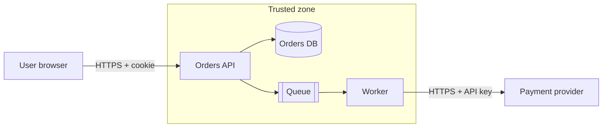

# Threat modeling

The four questions:
1. **What are we working on?**
2. **What can go wrong?**
3. **What are we going to do about it?**
4. **Did we do a good job?**

## Iron law
> **Model the system as it is (or will be), not as the diagram on the wiki says.** Ground every element in code, config or a design doc you've read.

## Procedure

### 1. Scope and assets
- What's in scope (feature, service, repo, agent fleet) and what's explicitly out.
- **Assets:** what an attacker wants. Data (PII, credentials, payment data, IP), capabilities (sending email, moving money, deploying), availability, reputation.
- **Actors:** legitimate users and roles, admins, services, *and* attackers (anonymous internet, malicious user, compromised dependency, insider, malicious content an agent reads).

### 2. Data-flow diagram
Draw it in Mermaid: external entities, processes, data stores, data flows, and **trust boundaries** (where privilege or trust level changes: internet → API, API → DB, app → third party, agent → tool, user content → LLM prompt).


### 3. Threats per element (STRIDE)
| Element type | Ask about |
|---|---|
| External entity | **S**poofing, **R**epudiation |
| Process | **S**, **T**ampering, **R**, **I**nformation disclosure, **D**enial of service, **E**levation of privilege |
| Data store | **T**, **I**, **D** (+ **R** if it holds audit logs) |
| Data flow | **T**, **I**, **D** |

For each element and letter, write concrete threats as **"An attacker who … can … because …, leading to …"**. Use [reference/stride-checklist.md](reference/stride-checklist.md) for prompts. Add **privacy threats** (LINDDUN: linking, identifying, non-repudiation, detecting, data disclosure, unawareness, non-compliance) when personal data is involved. Add **LLM and agent threats** (skill `llm-agent-security`) when a model reads untrusted content or calls tools.

### 4. Abuse cases
For each key user story, write the evil twin. "As a user I can view my order" → "As an attacker I change the order ID to view someone else's order."

### 5. Rate and rank
For each threat: **likelihood** (attacker effort, exposure, preconditions) × **impact** (confidentiality, integrity, availability, safety, money, compliance) → `critical / high / medium / low`. Note existing controls.

### 6. Mitigate
For each high or critical threat: **mitigate** (specific control), **eliminate** (remove the feature or data), **transfer** (a provider, insurance), or **accept** (named owner, reason, review date). Map to standard controls: authentication (S), integrity checks and signing (T), audit logging (R), encryption and access control (I), rate limits and quotas (D), authorization and least privilege (E).

### 7. Validate
Turn each mitigation into a testable requirement or test case (security unit test, integration test, config check). List the open questions you couldn't answer from the material.

## Output format
```
## Scope & assumptions
## Assets & actors
## Data-flow diagram        # mermaid, with trust boundaries
## Threats
| id | element | STRIDE | threat (attacker can … because … leading to …) | likelihood | impact | risk | existing controls |
## Abuse cases
## Mitigations
| threat id | action (mitigate/eliminate/transfer/accept) | control | test/verification | owner |
## Residual risk & open questions
```

## Red flags
- No trust boundaries drawn ("everything is internal").
- Threats with no attacker, capability or impact ("SQL injection is possible").
- Every risk rated "medium".
- Mitigations like "be careful" or "validate input" without saying where and how.
